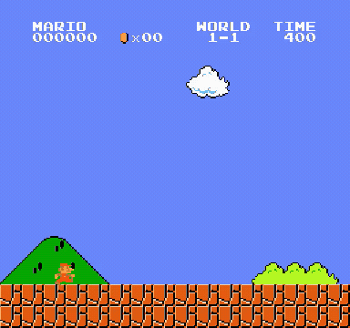
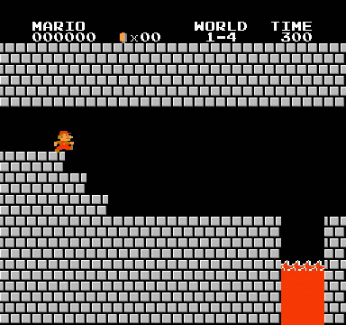
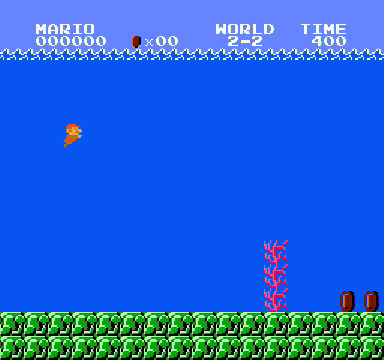

# Mario Search

**在原版 NES《Super Mario Bros.》中，通过存档搜索通关路线。**

CPU 上的最佳优先搜索：保存状态 → 尝试短动作 → 恢复状态 → 保留候选分支。
本项目是搜索版，运行不依赖 PyTorch、GPU 或预训练模型。

**已记录结果：29 / 32 关通关。** 每关独立从小 Mario 的原始入口开始，成功路线使用原始模拟器重放校验。

| World 1-1 · 地面关 | World 1-4 · 城堡关 | World 2-2 · 水下关 |
|:---:|:---:|:---:|
|  |  |  |
| 搜索约 **13.9 秒** | 搜索约 **9.5 秒** | 搜索约 **199.4 秒** |

GIF 来自已校验的实际路线录像，以 **2 倍速**展示。画面中的马里奥执行的是搜索得到的动作序列。[媒体来源](assets/README.md)

## 快速开始

已在 Linux / WSL2、Python 3.12 上验证。建议使用 Python 3.10–3.12。

```bash
git clone https://github.com/kzoacn/mario-search.git
cd mario-search

# Ubuntu / WSL2：C++ 编译器、Python 开发头文件和视频编码器
sudo apt-get install build-essential python3-dev python3-venv ffmpeg

python3 -m venv .venv
source .venv/bin/activate
python -m pip install --upgrade pip
python -m pip install -e ".[dev]"

# 搜索最多 5 分钟，并独立重放、录制结果
mario-search search --level 1-1 --seconds 300 --video --output runs/1-1
```

安装时会编译随仓库提供的 NES 存档扩展。没有 FFmpeg 时可去掉 `--video`，仅保存动作和搜索结果。

```bash
# 32 关，最多四关并行，每关至多 5 分钟
mario-search benchmark --seconds 300 --jobs 4 --video --output runs/all

# 指定关卡，15 分钟预算，扩大可保存节点数量
mario-search benchmark --levels 4-4 7-4 8-4 --seconds 900 \
  --max-nodes 20000 --jobs 3 --video --output runs/castles

# 重放仓库中已有的 1-1 成功路线，不进行搜索
mario-search replay --route benchmarks/routes/1-1.json --output runs/replay-1-1

# 只校验动作序列，不生成视频
mario-search replay --route benchmarks/routes/1-1.json \
  --output runs/verify-1-1 --verify-only

python -m pytest -q

# 可选：重放核对全部 32 条已保存路线，不重新搜索
python scripts/verify_archived_routes.py
```

批量运行后会生成本地录像页：

```bash
python -m http.server 8000 --bind 127.0.0.1 --directory runs/all
# 浏览 http://127.0.0.1:8000
```

## 算法

1. 每个节点保存完整的模拟器状态、观测历史、父节点和动作片段。
2. 按 **`x - 0.1 × 路径决策数`** 选择下一个节点。
3. 从相同存档分别试：向右跑、向右跑跳、向右跳、向右走、不按键。
4. 每个动作保持 4 次决策，每次决策重复 4 帧，通常共 **16 个游戏帧**。
5. 淘汰死亡分支，按位置、跳跃状态、速度和上一动作的近似 key 去重。
6. 碰到原生关卡结束信号 `flag_get` 时，沿父指针提取完整路线。

这是启发式最佳优先搜索，不保证最短路径或搜索完备性。累计游戏 reward 会被记录，但不参与节点排序。

搜索使用新增的 native 存档接口；视频重放使用一个新 Python 进程中的原始 `nes-py`，并检查终点、成功标志和动作数量。单条路线最多 1200 次决策。

## 实测结果

机器：AMD Ryzen 7 7800X3D，WSL2。搜索在 CPU 上执行。

| 实验 | 搜索预算 | 结果 |
|---|---|---|
| 全 32 关独立搜索 | 每关最多 180 秒 | 27 / 32 |
| 对未通关的 5 关重跑 | 每关最多 300 秒 | 新增 2-2、7-2，总计 **29 / 32** |
| 对 4-4、7-4、8-4 重跑 | 每关最多 900 秒，20000 节点 | 没有新增通关 |

保留已成功的较短预算结果；各次重跑都从原点和空候选池重新开始。环境准备、视频重放和编码不计入搜索预算。计时包含分支模拟、存档、排序和日志；临近截止时预留约 1 秒用于收尾。

这些是确定性搜索的关卡通过结果，不是神经网络的 sample 通关率，也不是 32 次新的 15 分钟实验。详细记录在 [benchmarks/results.json](benchmarks/results.json)，32 条可重放动作序列在 [benchmarks/routes/](benchmarks/routes/)。

## 已知限制

- 当前搜索动作不包含向左、向下、原地跳；它无法找到需要这些操作的路线。
- 横坐标在迷宫或区域切换时可能跳变。例如 4-4 的一次存活状态得到 `x=65535`，当前评分会被这个数值误导。**最大 x 不等于通关或完成比例。**
- 近似状态 key 没有包含全部敌人、区域和机关进度，可能误合并状态。
- 16 帧动作片段可能错过更细的时机；增加搜索时间不会自动补齐动作或状态表示。
- 存档扩展仅针对当前 NROM + CHR-ROM 游戏使用，存档只能恢复到创建它的模拟器实例。
- 复用记录与新安装后的搜索速度可能因 CPU、系统负载和依赖构建而变化。

未通关时的视频是搜索所选的存活前缀，不能作为通关证明。结果文件会明确标记 `success: false`。

## 文件结构

```text
mario_search/search.py       搜索核心
mario_search/native.py       完整状态捕获和恢复
mario_search/environment.py  原始游戏、动作和观测
mario_search/record.py       独立路线校验与录像
mario_search/cli.py          单关 / 批量 / 重放命令
vendor/nes-py/               带存档接口的 C++ 模拟器源码
benchmarks/                 已记录结果和动作序列
assets/                     README 动态 GIF
```

## 方法背景与致谢

相关先例包括 [Robin Baumgarten 的 Mario A*](https://github.com/amidos2006/Mario-AI-Framework)、[CUNI 的 A* Grid / Waypoints](https://gitlab.com/gamedev-cuni-cz/theses/super-mario-astar)、[Tom 7 的 NES 自动化项目](https://tom7.org/mario/)以及 [Go-Explore](https://github.com/uber-research/go-explore)。本仓库实现的是一个简化搜索基线，未移植这些规划器。

NES 核心来自 [nes-py](https://github.com/Kautenja/nes-py)；图像与奖励包装适配自 [Viet Nguyen 的 Mario PPO 项目](https://github.com/vietnh1009/Super-mario-bros-PPO-pytorch)。版权说明见 [THIRD_PARTY_NOTICES.md](THIRD_PARTY_NOTICES.md)。本仓库不包含 ROM、模型权重或本机运行配置。

代码采用 MIT 许可证；Mario 游戏画面不属于该代码许可证。
